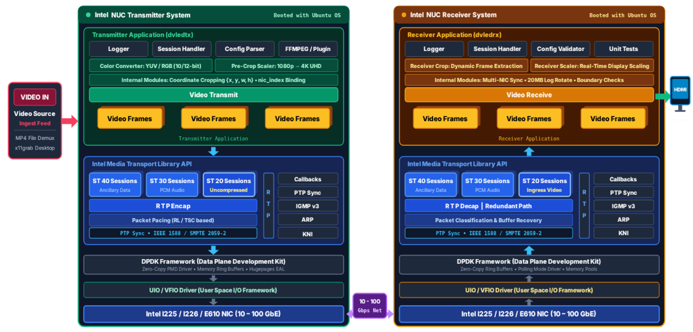

# Direct View LED Software Toolkit

[](LICENSE)
[](https://github.com/OpenVisualCloud/directview-led-software-toolkit/actions/workflows/ci.yml)
<a href="https://scan.coverity.com/projects/openvisualcloud-directview-led-software-toolkit"></a>
[](https://releases.ubuntu.com/jammy/)
[](https://github.com/OpenVisualCloud/Media-Transport-Library)
[](https://securityscorecards.dev/viewer/?uri=github.com/OpenVisualCloud/directview-led-software-toolkit)

## Table of Contents

- [Overview](#overview)
  - [Architecture](#architecture)
  - [System Requirements](#system-requirements)
  - [Deployment Security Model](#deployment-security-model)
- [Documentation Map](#documentation-map)
- [Notices](#notices)
- [Install](#install)
  - [1. MTL and DPDK](#1-mtl-and-dpdk)
  - [2. FFmpeg with the MTL Plugin](#2-ffmpeg-with-the-mtl-plugin)
  - [3. Toolkit Packages](#3-toolkit-packages)
  - [4. Verify the Installation](#4-verify-the-installation)
- [Host Setup](#host-setup)
  - [IOMMU / VFIO Kernel Parameters (GRUB)](#iommu--vfio-kernel-parameters-grub)
  - [VFIO Group Setup](#vfio-group-setup)
  - [Bind NICs to DPDK and Configure Hugepages](#bind-nics-to-dpdk-and-configure-hugepages)
- [Build](#build)
- [Run](#run)
  - [Command-Line Options](#command-line-options)
  - [Run the Transmitter (dvledtx)](#run-the-transmitter-dvledtx)
  - [Run the Receiver (dvledrx)](#run-the-receiver-dvledrx)
  - [End-to-End Example](#end-to-end-example)
  - [Stopping the Applications](#stopping-the-applications)
- [Running Unit Tests](#running-unit-tests)
- [Troubleshooting](#troubleshooting)
- [Contributing](#contributing)
- [License](#license)

## Overview

The Direct View LED Software Toolkit drives direct-view LED walls with uncompressed video over IP
using SMPTE ST 2110-20. It is built on FFmpeg and the
[Media Transport Library (MTL)](https://github.com/OpenVisualCloud/Media-Transport-Library) and
contains two applications:

| Application | Role | Details |
|-------------|------|---------|
| **dvledtx** | Transmitter. Decodes a video file (or captures an X11 screen), optionally scales it, splits it into crop regions and sends each region as an independent ST 2110-20 stream. | [dvledtx/README.md](dvledtx/README.md) |
| **dvledrx** | Receiver. Receives one or more ST 2110-20 streams and renders them on X11 displays — one window, a composite of all streams, or one window per physical output (HDMI/DP). | [dvledrx/README.md](dvledrx/README.md) |

**Use case — LED video walls:** drive multiple LED panels from a single source, with each panel
(or LED controller) receiving its own cropped portion of the frame.

### Architecture



### System Requirements

| Component | Requirement |
|-----------|-------------|
| **OS** | Ubuntu 22.04 LTS and Ubuntu 24.04 LTS |
| **CPU** | Intel 12th Gen Core processors or above, including Intel Core Ultra Series 3 |
| **NIC** | Intel Ethernet Controller I225 or above (I225, I226, E610 and E810 series) |
| **Memory** | Hugepages configured (typically 2 GB+) |
| **Kernel** | IOMMU and VFIO support enabled |
| **Display (RX only)** | An X11 (Xorg) session; Wayland is not supported |

### Deployment Security Model

dvledtx and dvledrx follow a layered security model. The applications validate and bound their
inputs — including configuration parsing, log file destinations, decoder behaviour and resource
limits — and are covered by static analysis, AFL/libFuzzer fuzzing and dependency CVE tracking in
CI. Transport-level security is a separate layer: SMPTE ST 2110-20 and the PTP timing it depends
on do not define authentication, encryption or integrity protection, which is a property of the
standards common to all ST 2110 equipment. The deployment architecture supplies that layer.

> **We recommend that all hosts in a deployment are air-gapped.** The TX host, a dedicated L2
> switch and the receivers sit inside a locked cabinet with no network path to any other network
> and no in-band administrative access — no SSH, no management NIC, no remote console, BMC
> disabled — with administration by physical KVM inside the cabinet. Because "isolated" and
> "restricted" are used loosely, note that a VLAN on a shared switch, a firewall or a jump host
> does not meet this definition.

We also recommend hardening the dedicated switch, since its configuration carries the boundary:
disable and blackhole every unused port, enable port security (802.1X or sticky MAC) with a
shutdown violation action, disable dynamic trunking, and enable IGMP snooping, storm control,
BPDU guard and DHCP snooping.

See **[Deployment Assumptions and Security Model](docs/assumptions.md)** for the trust boundary,
deployment assumptions, switch hardening recommendations, controlled ingress of configuration and
video content, the controls the toolkit implements, the residual risk, and a commissioning
validation checklist.

## Documentation Map

| Topic | Document |
|-------|----------|
| Install, build, host setup and quick start (TX and RX) | This README |
| Transmitter: JSON configuration, formats, scaling, PTP, VA-API decode, screen capture, logging | [dvledtx/README.md](dvledtx/README.md) |
| Receiver: JSON configuration, display modes, multi-monitor walls, PTP, logging | [dvledrx/README.md](dvledrx/README.md) |
| Deployment assumptions and security model | [docs/assumptions.md](docs/assumptions.md) |
| Reporting security issues | [Security.md](Security.md) |

## Notices

### FFmpeg

FFmpeg is an open source project licensed under LGPL and GPL. See https://www.ffmpeg.org/legal.html.
You are solely responsible for determining if your use of FFmpeg requires any additional licenses.
Intel is not responsible for obtaining any such licenses, nor liable for any licensing fees due, in
connection with your use of FFmpeg.

## Install

Both applications build on the Media Transport Library (MTL), DPDK and FFmpeg with the MTL plugin.
Install those by following MTL's own guides at the pinned commit, then add the few extra packages
that dvledtx and dvledrx need.

| Dependency | Version | Source |
|------------|---------|--------|
| Media Transport Library | MTL 26.01+, commit [`7bee2423`](https://github.com/OpenVisualCloud/Media-Transport-Library/tree/7bee24231c864d12da6db2c2ffbfd3986717af5a) (`26.01.0.DEV`) | [MTL build guide](https://github.com/OpenVisualCloud/Media-Transport-Library/blob/7bee24231c864d12da6db2c2ffbfd3986717af5a/doc/build.md) |
| DPDK | 26.03 (`DPDK_VER`) with the MTL patches | [`versions.env`](https://github.com/OpenVisualCloud/Media-Transport-Library/blob/7bee24231c864d12da6db2c2ffbfd3986717af5a/versions.env) at the pinned commit |
| FFmpeg | 7.0 (`FFMPEG_VERSION`) with the MTL plugin | [`versions.env`](https://github.com/OpenVisualCloud/Media-Transport-Library/blob/7bee24231c864d12da6db2c2ffbfd3986717af5a/versions.env) at the pinned commit |

These are the versions CI builds against. Supported OS: Ubuntu
[22.04](https://releases.ubuntu.com/jammy/) and [24.04](https://releases.ubuntu.com/noble/) LTS.

### 1. MTL and DPDK

Clone MTL at the pinned commit:

```bash
git clone https://github.com/OpenVisualCloud/Media-Transport-Library.git
cd Media-Transport-Library
git checkout 7bee24231c864d12da6db2c2ffbfd3986717af5a
export mtl_source_code=${PWD}
cd ..
```

Then follow the MTL build guide at that commit:

- [Install the build dependencies](https://github.com/OpenVisualCloud/Media-Transport-Library/blob/7bee24231c864d12da6db2c2ffbfd3986717af5a/doc/build.md#111-ubuntudebian)
- [Build and install DPDK](https://github.com/OpenVisualCloud/Media-Transport-Library/blob/7bee24231c864d12da6db2c2ffbfd3986717af5a/doc/build.md#2-dpdk-build-and-install)
- [Build and install MTL](https://github.com/OpenVisualCloud/Media-Transport-Library/blob/7bee24231c864d12da6db2c2ffbfd3986717af5a/doc/build.md#3-build-media-transport-library-and-app)

> **DPDK version:** use the `DPDK_VER` from `versions.env` (26.03) and the matching
> `${mtl_source_code}/patches/dpdk/26.03/` patches. The example commands in the guide at this
> commit still show 25.11.

### 2. FFmpeg with the MTL Plugin

Install the [dvledtx packages](#3-toolkit-packages) first, then follow the
[MTL FFmpeg plugin build guide](https://github.com/OpenVisualCloud/Media-Transport-Library/blob/7bee24231c864d12da6db2c2ffbfd3986717af5a/ecosystem/ffmpeg_plugin/README.md#1-build)
at the pinned commit. FFmpeg's `./configure` only picks up optional features whose packages are
already installed.

- **Screen capture** (dvledtx `input_mode: screen_capture`) needs FFmpeg's `x11grab` device, which
  is only compiled in when the `libxcb*` packages are installed before `./configure`.
- **Hardware decode** (dvledtx `"hwaccel": true`) needs `--enable-vaapi` added to the plugin
  guide's `./configure` line.
- **12-bit formats** (`yuv422p12le`, `yuv444p12le`, `gbrp12le`) need MTL **and** FFmpeg built from
  the same pinned commit. The plugin sources are compiled into FFmpeg's `libavdevice`, so
  rebuilding MTL alone is not enough.
- **Up to 8 NICs** on the default dvledtx FFmpeg TX path rely on the `p2_port`..`p7_port`
  AVOptions present in the plugin at the pinned commit.

### 3. Toolkit Packages

These packages are needed on top of the MTL and FFmpeg prerequisites.

**dvledtx**

```bash
# Screen capture (FFmpeg x11grab), install before configuring FFmpeg
sudo apt-get install -y libxcb1-dev libxcb-shm0-dev libxcb-xfixes0-dev
# Optional: VA-API hardware decode, install before configuring FFmpeg
sudo apt-get install -y libva-dev vainfo intel-media-va-driver-non-free
```

**dvledrx**

```bash
sudo apt-get install -y libx11-dev libxext-dev libxrandr-dev zlib1g-dev
```

| Application | Packages | Used for |
|-------------|----------|----------|
| dvledtx | `libxcb1-dev`, `libxcb-shm0-dev`, `libxcb-xfixes0-dev` | FFmpeg `x11grab`, for `input_mode: screen_capture` |
| dvledtx (optional) | `libva-dev`, `vainfo`, `intel-media-va-driver-non-free` | VA-API hardware decode, for `"hwaccel": true` |
| dvledrx | `libx11-dev`, `libxext-dev`, `libxrandr-dev` | X11 rendering, MIT-SHM and XRandR output placement |
| dvledrx | `zlib1g-dev` | Log file compression |

dvledrx also uses `libjson-c-dev`, which is already installed with the MTL prerequisites.

### 4. Verify the Installation

```bash
pkg-config --modversion libdpdk          # expected: 26.03.x
pkg-config --modversion mtl              # expected: 26.01.0.DEV
ls /usr/local/include/mtl/mtl_api.h      # MTL headers present
ldconfig -p | grep libmtl                # libmtl.so => /usr/local/lib/x86_64-linux-gnu/libmtl.so
pkg-config --modversion libavformat      # FFmpeg 7.0 (libavformat 61.x)
ffmpeg -hide_banner -muxers  | grep mtl_st20p   # MTL plugin present
ffmpeg -hide_banner -devices | grep x11grab     # dvledtx screen capture
ffmpeg -hide_banner -hwaccels | grep vaapi      # optional: dvledtx hardware decode
```

## Host Setup

These steps are required on **both** the TX and RX hosts. They only need to be done once
(hugepages and NIC binding must be repeated after each reboot unless made persistent).

### IOMMU / VFIO Kernel Parameters (GRUB)

MTL requires IOMMU and VFIO. Ensure these parameters are present in `GRUB_CMDLINE_LINUX_DEFAULT`
in `/etc/default/grub`:

```
intel_iommu=on iommu=pt pcie_aspm=off pcie_port_pm=off vfio-pci.disable_idle_d3=1
```

For example:

```bash
sudo nano /etc/default/grub
# GRUB_CMDLINE_LINUX_DEFAULT="quiet splash intel_iommu=on iommu=pt pcie_aspm=off pcie_port_pm=off vfio-pci.disable_idle_d3=1"
sudo update-grub
sudo reboot
```

Verify after reboot:

```bash
cat /proc/cmdline | grep intel_iommu
dmesg | grep -i iommu    # should show "DMAR: IOMMU enabled"
```

### VFIO Group Setup

MTL accesses the NIC through VFIO; the user running the applications must belong to the `vfio`
group:

```bash
sudo groupadd vfio            # if it does not already exist
sudo usermod -aG vfio $USER
newgrp vfio                   # or log out and back in
id -nG $USER                  # verify
```

### Bind NICs to DPDK and Configure Hugepages

Follow the MTL run guide for the pinned commit:

- [DPDK PMD setup](https://github.com/OpenVisualCloud/Media-Transport-Library/blob/7bee24231c864d12da6db2c2ffbfd3986717af5a/doc/run.md#3-dpdk-pmd-setup) — bind the NIC (or create and bind VFs) to `vfio-pci`.
- [Hugepage setup](https://github.com/OpenVisualCloud/Media-Transport-Library/blob/7bee24231c864d12da6db2c2ffbfd3986717af5a/doc/run.md#4-setup-hugepage).

Quick reference:

```bash
# Find the NIC PCI address (use the BDF form "0000:06:00.0" in the JSON configs)
lspci | grep Ethernet

# Bind a PF to vfio-pci, or create VFs on it
sudo ${mtl_source_code}/script/nicctl.sh bind_pmd 0000:06:00.0
sudo ${mtl_source_code}/script/nicctl.sh create_vf 0000:06:00.0   # alternative: VFs
dpdk-devbind.py --status       # target NIC/VFs should show drv=vfio-pci

# Allocate hugepages
sudo sysctl -w vm.nr_hugepages=2048
grep Huge /proc/meminfo
```

## Build

With the dependencies installed, clone the repository and build both applications:

```bash
git clone https://github.com/OpenVisualCloud/directview-led-software-toolkit
cd directview-led-software-toolkit
bash scripts/build.sh
```

The script wipes and recreates `build/`, then produces:

| Binary | Path |
|--------|------|
| Transmitter | `build/dvledtx/dvledtx` |
| Receiver | `build/dvledrx/dvledrx` |

Extra Meson options are passed straight through. The only project option selects the dvledtx TX
path (it does not affect dvledrx):

| Option | Default | Description |
|--------|---------|-------------|
| `enable_mtl_tx` | `false` | `false`: transmit through FFmpeg's `mtl_st20p` muxer. `true`: transmit with MTL's pipeline API (`st20p_tx_*`) directly. |

```bash
bash scripts/build.sh -Denable_mtl_tx=true
```

Manual equivalent:

```bash
meson setup build [-Denable_mtl_tx=true]
ninja -C build
```

## Run

Both applications are configured entirely from a JSON file and share the same command line.
Before running, make sure the [host setup](#host-setup) is complete and edit the sample config so
`interfaces[].name` matches your NIC PCI address and the IP addresses match your network.

### Command-Line Options

| Option | Description |
|--------|-------------|
| `-C, --config <file>` | JSON configuration file (required) |
| `-t, --test-time <secs>` | Run for N seconds (1..86400), then exit cleanly |
| `-v, --version` | Show the version and exit |
| `--help` | Show usage |

### Run the Transmitter (dvledtx)

```bash
./build/dvledtx/dvledtx --config dvledtx/config/tx_fullhd_single_session.json
```

Set `video.tx_url` in the config to your source video file (or use `input_mode:
screen_capture`). Configuration reference:
[dvledtx/README.md — JSON Configuration](dvledtx/README.md#json-configuration).

### Run the Receiver (dvledrx)

dvledrx renders through X11, so it needs a running Xorg session and `DISPLAY` set:

```bash
export DISPLAY=:0
./build/dvledrx/dvledrx --config dvledrx/config/rx_fullhd_1session.json
```

Configuration reference:
[dvledrx/README.md — JSON Configuration](dvledrx/README.md#json-configuration).

### End-to-End Example

A TX session and the RX session that receives it must agree on:

| Must match | TX config | RX config |
|------------|-----------|-----------|
| Multicast group | `interfaces[].dip` | `interfaces[].dip` |
| UDP port | `tx_sessions[].udp_port` | `rx_sessions[].udp_port` |
| RTP payload type | `tx_sessions[].payload_type` | `rx_sessions[].payload_type` |
| Pixel format | `tx_video.fmt` | `video.fmt` |
| Frame rate | `tx_video.fps` | `video.fps` |
| Stream size | `tx_sessions[].crop.w` × `crop.h` | `rx_sessions[].crop.w` × `crop.h` |

For example, a Full HD frame split into three 640×1080 strips:

```bash
# TX host
./build/dvledtx/dvledtx --config dvledtx/config/tx_fullhd_multi_session.json

# RX host (composite window of the three strips)
export DISPLAY=:0
./build/dvledrx/dvledrx --config dvledrx/config/rx_crop_3sessions.json
```

The shipped samples are independent examples: before pairing them, align the multicast `dip`
and `fmt` values (here `tx_fullhd_multi_session.json` uses `239.168.85.21` / `yuv422p10le` and
`rx_crop_3sessions.json` uses `239.168.85.20` / `gbrp12le`).

### Stopping the Applications

Press `Ctrl+C` (or send `SIGTERM`) for a clean shutdown; `--test-time` stops automatically. Closing
a dvledrx window also stops the receiver. If an application becomes unresponsive:

```bash
pkill -9 -f dvledtx
pkill -9 -f dvledrx
```

## Running Unit Tests

```bash
sudo apt install -y libcmocka-dev xvfb xauth
pip install gcovr

bash scripts/test.sh                # TX + RX unit tests with a coverage report
bash scripts/test.sh --no-coverage  # tests only
```

The script builds into `build-tests/` and runs every test with `meson test`. dvledrx X11/session
tests run under `xvfb-run`. dvledtx screen-capture success tests run only when a live X display is
detected (or `DVLED_TEST_DISPLAY` is set to an x11grab source such as `:99.0+0,0`).

## Troubleshooting

Application-specific issues are covered in [dvledtx/README.md](dvledtx/README.md#troubleshooting)
and [dvledrx/README.md](dvledrx/README.md#troubleshooting). Common issues:

1. **MTL initialization failed**
   - Check that the PCI address in the config matches your hardware:
     ```bash
     lspci | grep Ethernet
     # Example output: 06:00.0 Ethernet controller: Intel Corporation ...
     # Use BDF format in config: "0000:06:00.0"
     ```
   - Check MTL, DPDK and FFmpeg are installed at the expected versions — see
     [Verify the Installation](#4-verify-the-installation).
   - Verify the NIC is bound to VFIO:
     ```bash
     sudo ${mtl_source_code}/script/nicctl.sh list all
     # Or use dpdk-devbind.py:
     dpdk-devbind.py --status
     # The target NIC should show "drv=vfio-pci"
     ```
   - Ensure IOMMU is enabled — see [IOMMU / VFIO Kernel Parameters](#iommu--vfio-kernel-parameters-grub).
   - Verify the network card is supported (Intel I225, I226, E610, E810 series).

2. **Hugepage allocation failure / transmission issues**
   ```bash
   grep Huge /proc/meminfo                  # HugePages_Free should be > 0
   sudo sysctl -w vm.nr_hugepages=2048      # make persistent in /etc/sysctl.conf
   ```
   Also check the NIC has enough bandwidth (uncompressed 1080p30 4:2:2 10-bit ≈ 1.3 Gb/s per
   stream, more for 4:4:4 / 12-bit).

3. **Permission denied (VFIO)**
   - Ensure the user is in the `vfio` group — see [VFIO Group Setup](#vfio-group-setup).
   - Check `ls -la /dev/vfio/` — group should be `vfio` with rw permissions.

4. **`pip install` fails with `externally-managed-environment`** (Ubuntu 24.04, PEP 668)
   - See the note in the
     [MTL build guide](https://github.com/OpenVisualCloud/Media-Transport-Library/blob/7bee24231c864d12da6db2c2ffbfd3986717af5a/doc/build.md#111-ubuntudebian),
     or install with `pip install --break-system-packages <package>`.

5. **FFmpeg `./configure` fails with `nasm/yasm not found or too old`**
   ```bash
   sudo apt install -y nasm
   ```
   Then re-run `./configure`.

6. **Build fails with `Dependency "mtl" not found` or missing `libav*`**
   - Make sure `/usr/local` is on the pkg-config path:
     ```bash
     export PKG_CONFIG_PATH=/usr/local/lib/pkgconfig:/usr/local/lib/x86_64-linux-gnu/pkgconfig:$PKG_CONFIG_PATH
     ```

## Contributing

Contributions are welcome. Please open an issue or submit a pull request on
[GitHub](https://github.com/OpenVisualCloud/directview-led-software-toolkit).

## License

This project is licensed under the BSD 3-Clause License. See [LICENSE](LICENSE) for details.
